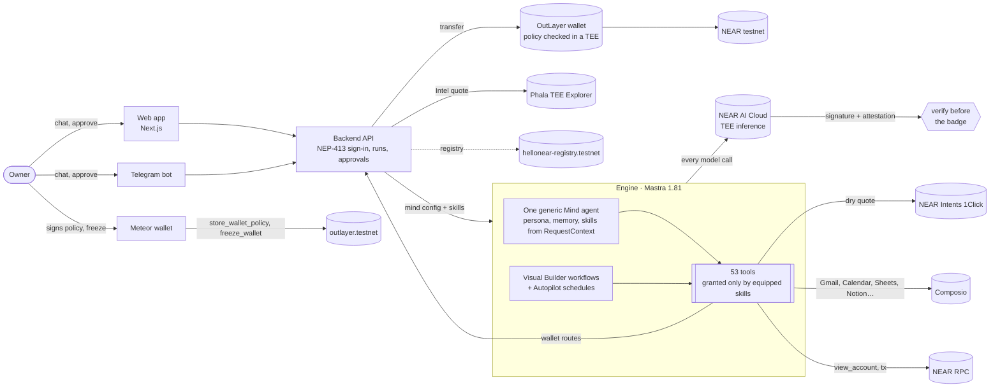
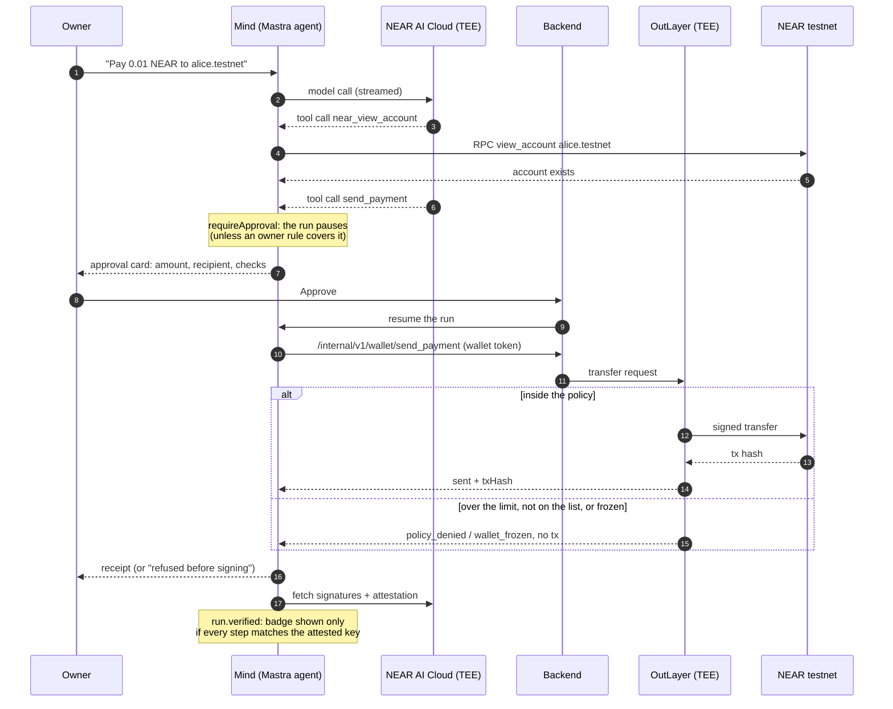

<div align="center">


# HelloNear

### An AI agent that can pay for you, with the money rules out of its reach.

HelloNear gives a person a **Mind**: an AI agent with a persona, memory, skills it can equip and its own NEAR wallet. It reads your email, works in your apps and pays your bills, but **every limit that matters sits outside the model**: the owner approves, and the wallet's policy is checked inside a TEE before anything is signed. Every reply comes from NEAR AI Cloud's TEE with a proof you can check yourself.

<br>


<br>

### Live now

| | |
|---|---|
| **Web app** (no account needed: *Continue as guest*) | **[app.hellonear.xyz](https://app.hellonear.xyz)** |
| **Landing page** | **[hellonear.xyz](https://hellonear.xyz)** |
| **API** (NEAR testnet) | **[api.hellonear.xyz/v1/health](https://api.hellonear.xyz/v1/health)** |
| **Mind registry contract** | **[`hellonear-registry.testnet`](https://testnet.nearblocks.io/address/hellonear-registry.testnet)** (v0.3.0, NEP-330, [source verified](https://testnet.nearblocks.io/address/hellonear-registry.testnet?tab=contract)) |
| **API reference** | **[OpenAPI spec](docs/openapi.json)** · [README section](#api-reference) |
| **Repository** | **[github.com/Hellonear-AI/hellonear](https://github.com/Hellonear-AI/hellonear)** |

**[The agent and its 53 tools](#the-agent-mastra-on-near-ai-cloud)** ·
**[Receipts](#receipts-check-them-yourself)** ·
**[Security model](#security-model)** ·
**[Try it](#try-it)** ·
**[API reference](#api-reference)** ·
**[Limits](#limits)**

Built at **NEAR HACKATHON** (1 to 14 Nov 2026) for six tracks: `security`, `privacy`, `agents`, `swarms`, `business`, `realworld`.<br>1,000+ commits and 178 merged pull requests since the hackathon started.

<br>

  

<sub>The three Mind templates: General Assistant, Payments Mind, Email Manager.</sub>

</div>

---

## The problem

An AI assistant that can pay is one prompt injection away from paying the wrong person. A rule written in the system prompt ("never send more than X") is advice to the model, not a limit: a malicious email, calendar invite or web page can talk the model out of it. And an AI that reads your private email should not leak it to the infrastructure it runs on.

HelloNear's answer is to **take the limits out of the model** and **make the model's work verifiable**:

1. **Every payment asks the owner,** in the app or in Telegram, unless the owner turned on a rule for small payments to listed addresses. Without an approval or a rule, the payment tool cannot run.
2. **The wallet enforces its own policy.** Each Mind's wallet is an [OutLayer](https://outlayer.ai) wallet whose policy (per-payment limit, daily limit, allowed recipients) is stored on NEAR and checked in a TEE before anything is signed. A payment over the limit or to an unknown address is refused **even if the owner approved it**, and no transaction exists.
3. **Freeze.** One transaction, signed in the owner's own NEAR wallet, stops everything.
4. **Private, verifiable inference.** Every model call runs on NEAR AI Cloud inside a TEE. HelloNear checks each reply's signature against the hardware attestation before it shows the "Verified" badge, keeps that proof, and lets anyone open it on Phala's TEE Attestation Explorer.

---

## What it does

| Feature | What it means |
|---|---|
| **A Mind per job** | Pick a template (General Assistant, Payments Mind, Email Manager), give it a name and a voice. It remembers what matters, and you can read, edit or clear that memory. |
| **Skills grant tools** | 34 skills, each a playbook plus a fixed list of tools. A Mind has exactly the tools its skills grant, so a Mind without a payment skill cannot pay, whatever it is told. |
| **Approval cards** | Payments, emails, calendar changes, Sheets cells, Notion rows, Docs, Slack posts and Zoom meetings wait for the owner, with the old value shown next to the new one. |
| **A wallet with its own rules** | Per-payment limit, daily limit and allowed addresses, enforced by OutLayer in a TEE before signing; freeze with one signature. |
| **Cross-chain quotes** | A Payments Mind quotes a USDC or USDT payment from NEAR to Base, Solana, Arbitrum and more through **NEAR Intents**, with 1Click's signature checked. |
| **Proof behind every reply** | View proof shows each step's signature and Intel's TDX report; *Check it in TEE Explorer* opens a report that reads VERIFIED. |
| **Autopilot** | A visual Builder for scheduled jobs (Ask the Mind, Use a tool, Call a website, If or else). Jobs run unattended, so they get no payment tools at all. |
| **Attack playground** | Try to trick a test Mind into paying and see which layer stopped it. |
| **Telegram** | Chat with your Mind from Telegram, with streamed replies and Approve / Decline buttons. |
| **Your apps** | Gmail, Google Calendar and Meet, Sheets, Drive, Docs, Notion, Slack, Outlook and Zoom through Composio, plus the Mind's own email address. |

---

## Tracks

HelloNear is submitted to six tracks. For each one: what the organizers ask for (quoted from the *Build* and *Hints* columns of HACKATHON.md), what HelloNear built for it, the skills that carry it, and how to check it.

| Track | Why HelloNear fits, in one line |
|---|---|
| [`security`](#security-ai-security--defense) | An AI with money whose limits it cannot touch: approval, an OutLayer policy checked in a TEE before signing, freeze, scam and lookalike checks, and an Attack playground |
| [`privacy`](#privacy-privacy--private-ai) | Every reply runs on NEAR AI Cloud in a TEE and is verified against its attestation, with a proof anyone can open on Phala's TEE Explorer |
| [`agents`](#agents-agent-economy) | Minds pay for data (402), sell to other Minds, compare sellers, invoice, and quote payments through NEAR Intents, inside the owner's limits |
| [`swarms`](#swarms-ai-swarms) | Every purchase is a small auction between sellers; Minds trade with other Minds; one request pays several people, each approved |
| [`business`](#business-autonomous-business) | The owner sets the constraints; the Mind runs the treasury: reports, audits, revenue sharing, invoices, procurement, scheduled jobs |
| [`realworld`](#realworld-real-world-money) | Invoices with payment checked on chain, bills found in Gmail, and stablecoin payments to other chains quoted through NEAR Intents |

### `security`: AI Security & Defense

| | |
|---|---|
| **The track asks for** | "Build spending limits, policy engines, sandboxed wallets, reputation and scam detection. Give AI money without giving it the keys to everything." Hints: agent security, function call keys, TEE attestation |
| **What HelloNear built** | Seven layers that each stop an attack alone: the model, skills that grant tools, the owner's approval, the OutLayer wallet policy checked **in a TEE before signing**, a daily limit, freeze, and unattended jobs with no payment tools. Writes re-check their target before writing. A Recipient guard that answers allow, warn or block with the reason before every payment (where the recipient came from, that it exists, lookalikes of people already paid, first payments, contracts), a Phishing check, and an Attack playground that names the layer that stopped each attack. Why not function-call keys: they cannot transfer NEAR and their allowance is gas, not a spending cap |
| **Skills** | Recipient guard, Phishing check, Freeze advisor, Spending audit, Payments |
| **Check it** | Attack playground, any scenario: `attack.verdict` names the layer. Approve 1 NEAR: `policy_denied`, no transaction |

### `privacy`: Privacy & Private AI

| | |
|---|---|
| **The track asks for** | "Explore confidential computation, private finance and AI that protects sensitive data. Build intelligence without exposure." Hints: private AI, TEE, NEAR AI Cloud |
| **What HelloNear built** | Every model call runs on **NEAR AI Cloud** inside a TEE. Each reply's signature is checked against the hardware attestation before the Verified badge shows; the proof is kept, shown under View proof, and opens on Phala's TEE Explorer as VERIFIED. Secrets and wallet tokens never reach the model, traces or stored snapshots. Skills that read sensitive email without sending it anywhere |
| **Skills** | Confidential reader, Redact before send, Health journal |
| **Check it** | Verified badge → View proof → Check it in TEE Explorer: a VERIFIED report whose nonce matches the dialog. What is kept and what is not: [What is private, and what HelloNear keeps](#what-is-private-and-what-hellonear-keeps) |

### `agents`: Agent Economy

| | |
|---|---|
| **The track asks for** | "Build agents that earn, spend, negotiate, hire other agents and pay for APIs, compute or data — with crypto directly or through NEAR Intents." Hints: agent commerce, NEAR Intents, chain signatures |
| **What HelloNear built** | Minds pay for data with a 402 pattern on testnet NEAR (price, approved payment, report with the tx hash as receipt), sell what they made to other Minds into their own wallet, compare sellers before buying, invoice and check payment on chain, quote cross-chain payments through **NEAR Intents**, haggle once with a seller (offer within the owner's budget, then buy at the agreed price or walk away), and find agents on the **NEAR AI Agent Market** (market.near.ai) with each job's exact price from the agent's own x402 answer, picking the cheapest one within the owner's budget (hiring is paid in USDC on mainnet, so it only quotes for now). All inside the owner's limits |
| **Skills** | Paid data, Best price buyer, Hire on Agent Market, Price watch, Mind as seller, Invoice & get paid, Payments |
| **Check it** | *"What's the gas price on NEAR testnet? Buy the report."*: a `402` price, a card for 0.001 NEAR, then the report and its tx hash |

### `swarms`: AI Swarms

| | |
|---|---|
| **The track asks for** | "Build coordination markets, bidding, collective purchasing, intent-based settlement and emergent economies between agents." Hints: multi-agent systems, NEAR Intents, sub-accounts |
| **What HelloNear built** | A **sealed-bid group-buying auction contract** ([`sc/swarm`](sc/swarm), rules in [`RULES.md`](sc/swarm/RULES.md)): buyer agents pool demand with escrow, seller agents commit hidden asks with a bond and reveal them, the cheapest asks fill demand at one clearing price, and every agent is its own NEAR sub-account. A simulation of **20 buyers and 5 sellers with scripted strategies and no LLM** runs three rounds on a local NEAR sandbox and checks money is conserved each round ([report](sc/swarm/simulation-report.md)); an independent audit's 9 findings are fixed. In the app, Best price buyer runs each order as a small auction between sellers and buys only from one the wallet may pay; Minds buy from and sell to other Minds (each with its own wallet); Split bill and Revenue split pay several people from one request, each payment approved on its own |
| **Skills** | Best price buyer, Mind as seller, Split bill, Revenue split; contract `sc/swarm` |
| **Check it** | `cd sc/swarm && cargo test --test simulation -- --nocapture`: 20 buyers and 5 sellers, three rounds, a clearing price per round and who got what. In the app: *"Split 0.02 NEAR between alice.testnet and bob.testnet"*: shares worked out in yoctoNEAR, one card per person |

### `business`: Autonomous Business

| | |
|---|---|
| **The track asks for** | "Build AI-native businesses with treasury, sales, procurement, cross-chain payments via NEAR Intents and revenue sharing. Humans only set the constraints." Hints: AI agents, NEAR Intents, chain signatures |
| **What HelloNear built** | The owner sets the constraints (per-payment and daily limits, allowed recipients, approval rules) and holds a kill switch (Freeze, one signature); the Mind runs the treasury: daily treasury reports, a weekly spending audit, revenue sharing between partners, invoices and follow-ups, procurement through Best price buyer, cross-chain quotes through NEAR Intents, and Autopilot jobs that run on a schedule |
| **Skills** | Treasury report, Spending audit, Revenue split, Invoice & get paid, Follow-ups, Subscriptions & bills |
| **Check it** | *"Give me today's treasury report"*: balance, what went out, what is pending, read only |

### `realworld`: Real-World Money

| | |
|---|---|
| **The track asks for** | "Build payroll, invoicing, remittances, merchant payments and stablecoin rails for real businesses. Something a normal company could use tomorrow." Hints: stablecoins, NEAR Intents, meta transactions |
| **What HelloNear built** | Invoices sent from the Mind's own email address with payment checked by its transaction on chain; bills and subscriptions found in the owner's Gmail; a payments CSV an accountant can open without asking (`GET /v1/minds/{id}/payments.csv`: date, status in words, amount, counterparty, purpose, who approved, tx hash and NearBlocks link); a meta-transaction relayer (NEP-366) that pays gas only for owner calls to our own registry contract and never pays a deposit; USDC/USDT payments to other chains quoted through **NEAR Intents**, signed by 1Click and checked with the official SDK (sending needs mainnet); every payment approved by the owner and limited by the wallet |
| **Skills** | Invoice & get paid, Subscriptions & bills, Spending tracker, Payments |
| **Check it** | *"Send 10 USDC to 0x8ba1f109551bD432803012645Ac136ddd64DBA72 on Base."*: what would arrive, the cost, the time, `proof.signedBy1Click: true`, nothing sent |

---

## Connectors

What a Mind can work with. Logos are the ones the web app shows on the Connections screen (rendered from `apps/fe/src/components/elements/AppLogos.tsx`); each is its owner's trademark, used to name the app.

| | Connector | How it connects | What a Mind can do with it |
|---|---|---|---|
|  | **Gmail** | Composio (OAuth, the owner's account) | Read and search mail, save drafts, archive or label after approval. No send tool exists |
|  | **Google Calendar** | Composio | Read events, find free time, add an event, move an event, all with times on the owner's clock |
|  | **Google Meet** | Composio | Schedule a meeting with guests the owner named and a Meet link, after approval |
|  | **Google Sheets** | Composio | Find and read sheets, add a row, change cells with the old value shown first |
|  | **Google Drive** | Composio | Search files by name and content |
|  | **Google Docs** | Composio | Read a Doc, create one, add text at the end (never replaces) |
|  | **Notion** | Composio | Search and read pages and databases, add a page or a row, change a row's properties |
|  | **Slack** | Composio | List channels, post a message the owner approved |
|  | **Outlook** | Composio | Read mail and save reply drafts (no send) |
|  | **Zoom** | Composio | List meetings, schedule one with a join link, read Zoom's AI summary of a past meeting |
|  | **Telegram** | A bot per Mind, made by the owner with BotFather | Chat with the Mind, streamed replies, Approve / Decline buttons on cards; only the owner's chat is answered |
|  | **The Mind's own email address** | AgentMail, one inbox per Mind | Send from `…@agentmail.to` after approval, only to addresses the owner typed; read its own inbox with spam and phishing warnings |
|  | **NEAR wallet** (Meteor first) | NEAR Connect, NEP-413 sign-in | The owner signs in, sets the Mind wallet's limits and freezes it; the Mind never holds the owner's keys |
|  | **HTTP request** (your own APIs) | API keys the owner saves in Connections, stored encrypted | Call any HTTPS API the owner uses (a store, a CRM, a webhook) with the owner's key, only on the hosts the owner listed; the Mind writes `{{secrets.NAME}}` and never sees the key |

---

## Tech stack: what is used where

| | Technology | Where in the repo | What it does in HelloNear |
|---|---|---|---|
| <picture><source media="(prefers-color-scheme: dark)" srcset="docs/readme/brands/near-white.svg"></picture> | **NEAR Protocol** (testnet) | `sc/`, `apps/be/src/auth.ts`, `apps/be/src/wallets.ts` | The Mind registry contract (Minds, published skills, `equip_skill` pays the publisher); NEP-413 sign-in; every payment, policy change and freeze is a NEAR transaction |
|  | **NEAR AI Cloud** | `engine/src/models.ts`, `engine/src/verify.ts`, `engine/src/titles.ts` | Runs every model call inside a TEE; HelloNear checks each reply's signature against the attestation before the Verified badge, and keeps the proof |
| | **NEAR Intents** (1Click API + official SDK) | `engine/src/crosschain.ts` | Cross-chain USDC/USDT quotes from NEAR to other chains; each quote's 1Click signature is verified with `verifyQuoteSignature` |
|  | **OutLayer** (testnet) | `apps/be/src/wallets.ts`, `apps/be/src/payments.ts` | One wallet per Mind; its policy (per-payment limit, daily limit, allowed recipients) is stored on chain and checked in a TEE before anything is signed; freeze |
|  | **Meteor Wallet** via **NEAR Connect** | `apps/fe` | The owner's wallet: signs in, signs the Mind wallet's policy, adds funds, freezes. Other NEAR Connect wallets work too |
| | **FastNear** testnet RPC | `engine/src/tools.ts`, `apps/be/src/config.ts` | Account lookups before a payment (`view_account`) and transfer checks after one (`tx`) |
| | **Phala TEE Attestation Explorer** | `apps/be/src/teeExplorer.ts` | Checks the Intel TDX quote behind a reply; the app opens its VERIFIED report |
| <picture><source media="(prefers-color-scheme: dark)" srcset="docs/readme/brands/mastra-white.svg"></picture> | **Mastra** 1.81 | `engine/` | The agent: one generic Mind agent, tools, approvals (`requireApproval`, per-call rules, `beforeApproval`), memory, context limits, dynamic workflows for the Builder, workflow schedules for Autopilot |
|  | **GLM-5.3 Flash** (Z.ai), **DeepSeek V4.1 Flash**, **Qwen3 Embedding** | `engine/src/config.ts`, `engine/src/models.ts` | Chat, reasoning and memory embeddings, all served by NEAR AI Cloud |
| <picture><source media="(prefers-color-scheme: dark)" srcset="docs/readme/brands/composio-white.svg"></picture> | **Composio** | `apps/be/src/connections.ts`, `engine/src/composio.ts`, `engine/src/apps.ts`, `engine/src/calendar.ts`, `engine/src/zoom.ts` | The owner connects Gmail, Google Calendar, Meet, Sheets, Drive, Docs, Notion, Slack, Outlook and Zoom with OAuth (backend: Connect Links); the engine runs the app tools in a session scoped to that one owner |
| <picture><source media="(prefers-color-scheme: dark)" srcset="docs/readme/brands/agentmail-white.svg"></picture> | **AgentMail** | `apps/be/src/mail.ts`, `engine/src/mail.ts` | Each Mind's own email address (`…@agentmail.to`): send after approval, read its inbox with spam and phishing warnings, email the owner |
|  | **Telegram Bot API** | `apps/be/src/telegram.ts`, `apps/be/src/telegramFormat.ts` | A bot per Mind: chat, streamed replies, Approve / Decline buttons; only the owner's chat is answered |
| | **Postgres 17 + pgvector** | `apps/be/migrations/`, `engine/src/mastra.ts` | Runs, events, approvals, encrypted secrets (backend); Mastra storage, run snapshots and memory vectors (engine) |
| | **Next.js 16, React 19, GSAP, React Flow** | `apps/fe`, `apps/landing` | The web app (chat, live view, Builder canvas, wallet, settings) and the landing page |
| | **Rust, `near-sdk` 5.29, `near-sandbox`** | `sc/` | The registry contract and its sandbox tests, including upgrades |
| | **Bun, Node 24, k6** | every package | Package manager and runtime; load tests |
| | **Proxmox LXC + Cloudflare Tunnel** | `deploy/` | The hosted demo; a merged `main` is deployed automatically after its CI passes |

---

## Receipts: check them yourself

Every link opens a public explorer or report. Nothing here needs an account.

### On NEAR testnet

| What happened | Transaction | What it proves |
|---|---|---|
| A Mind's wallet paid 0.01 NEAR after the owner approved, through the hosted stack | [`AKYYpkLq…`](https://testnet.nearblocks.io/txns/AKYYpkLq8XxjL4GKJqdGF5CVTLmjNh3AGEpz2rbcfyYT) | `Transfer` from the Mind wallet `83e05486…` to `lin1er.testnet`. The agent pays from its own wallet, never the owner's |
| An owner saved the Mind's limits, signed in Meteor | [`DhKqbLAX…`](https://testnet.nearblocks.io/txns/DhKqbLAX3zhH2tP3kJDx5Xsk8ZkMByfJbYLyWYyivXXZ) | `store_wallet_policy` on `outlayer.testnet`: the policy lives on chain, set by the owner, not by HelloNear |
| An owner froze the Mind's wallet | [`HHGf2pqG…`](https://testnet.nearblocks.io/txns/HHGf2pqGRGTEJuA7wn4R18swFC4ssL6XMyXyogFHkDgu) | `freeze_wallet` on `outlayer.testnet`: one signature stops every payment |
| A payment went through right after the UTC day reset of the daily limit | [`GUn5P1Dp…`](https://testnet.nearblocks.io/txns/GUn5P1DpuJ3XxMw2s9GJAecHR1BVuVtr4wQhTZ54RjG) | The daily cap is enforced by the wallet and resets at 00:00 UTC |
| The Mind registry contract upgraded to v0.3.0 | [`ESMY36Uo…`](https://testnet.nearblocks.io/txns/ESMY36UoFcdWuw5fbShbNx13Fvf2NB1z1qWWypJNyCwp) | `DeployContract` on `hellonear-registry.testnet`; `contract_source_metadata` answers version 0.3.0, NEP-330 |
| The same v0.3.0 redeployed from a reproducible build, then source-verified | [`DmidjQmo…`](https://testnet.nearblocks.io/txns/DmidjQmoN15bj2qctXaXDefAW5NGJZFBPqqPPFJoa6Qb) | `build_info` names the build image and commit `95c2b3d`; NearBlocks shows the contract as verified through SourceScan (code hash `GUxsMNJd…`) |
| A Mind equipped a published skill, paying its publisher | [`6diDXaAY…`](https://testnet.nearblocks.io/txns/6diDXaAYmT8pMtVemsv4xtmzSE8DW7WM5Uprim6aU2a5) | `equip_skill` on the registry |

A payment the policy refuses has **no transaction at all**: OutLayer refuses it in the TEE before signing. The app and the Mind never show a tx link for one.

### The registry contract's source is verified

`hellonear-registry.testnet` runs exactly the code in this repository at commit `95c2b3d`. It was built reproducibly (NEP-330) and verified through SourceScan, so anyone can rebuild it and get the same hash.

| | |
|---|---|
| **Status** | **Verified**. The [NearBlocks contract tab](https://testnet.nearblocks.io/address/hellonear-registry.testnet?tab=contract) shows the verified source, and its verify page answers "Contract already verified" |
| **Code hash on chain** | `GUxsMNJdJKoFq7VJawNeCwW7GjGZE6TpURPj13ojEnub` |
| **Deploy transaction** | [`DmidjQmoN15bj2qctXaXDefAW5NGJZFBPqqPPFJoa6Qb`](https://testnet.nearblocks.io/txns/DmidjQmoN15bj2qctXaXDefAW5NGJZFBPqqPPFJoa6Qb) (12 Nov 2026, code-only, state unchanged) |
| **Source** | [`Hellonear-AI/hellonear@95c2b3d`](https://github.com/Hellonear-AI/hellonear/tree/95c2b3d839357583224b4c8fa64b0f03cddc3f80), folder `sc` |
| **Build image** | `sourcescan/cargo-near:0.21.1-rust-1.96.0@sha256:ccb22bb4e677ed022d8b9d1aa1b32f0af52dd0471ef1c32e48dedbf68ee6ee17` |
| **Verifier** | SourceScan `v2-verifier.sourcescan.testnet`; its record holds the same code hash and the source on IPFS (`QmX4dYjf9v798uF4Uuf11EPMA83Le84sCg6UsmaGdgrMdc`) |

Check it without a browser (public RPC, no key). Each command should print the value in the table:

```sh
RPC=https://test.rpc.fastnear.com

# 1. The code hash deployed on the account
curl -s $RPC -H 'content-type: application/json' -d '{"jsonrpc":"2.0","id":1,"method":"query","params":{"request_type":"view_account","finality":"final","account_id":"hellonear-registry.testnet"}}' | jq -r .result.code_hash

# 2. The contract names its own source and build (NEP-330 contract_source_metadata)
curl -s $RPC -H 'content-type: application/json' -d '{"jsonrpc":"2.0","id":1,"method":"query","params":{"request_type":"call_function","finality":"final","account_id":"hellonear-registry.testnet","method_name":"contract_source_metadata","args_base64":"e30="}}' | jq -r '.result.result | implode | fromjson | .build_info'

# 3. SourceScan's verification record for the account
curl -s $RPC -H 'content-type: application/json' -d '{"jsonrpc":"2.0","id":1,"method":"query","params":{"request_type":"call_function","finality":"final","account_id":"v2-verifier.sourcescan.testnet","method_name":"get_contract","args_base64":"eyJhY2NvdW50X2lkIjoiaGVsbG9uZWFyLXJlZ2lzdHJ5LnRlc3RuZXQifQ=="}}' | jq -r '.result.result | implode | fromjson | .code_hash'
```

To rebuild it yourself (needs Docker): `git checkout 95c2b3d && cd sc && cargo near build reproducible-wasm`, then compare the SHA-256 (base58) of `target/near/hellonear_mind_registry.wasm` with the code hash above.

### The proof behind a verified reply (NEAR AI Cloud TEE)

| | |
|---|---|
| **Claim** | The reply came from NEAR AI's gateway TEE, and every step was signed by the key that hardware vouches for. |
| **Where it is checked** | `engine/src/verify.ts`, before the badge is shown. The signatures, hashes (never the conversation) and Intel's TDX quote are kept on `run.verified`. |
| **Open it** | Verified badge → **View proof** → **Check it in TEE Explorer**. The backend uploads the Intel quote to Phala's TEE Attestation Explorer and the app opens the report. |
| **A real report** | [proof.t16z.com/reports/1b374e5b…](https://proof.t16z.com/reports/1b374e5b10031496c6c45bc7749038d7e7cd26a16996455f893b6b5dd44a9db2): **VERIFIED**. Its report data ends with that run's nonce (`…99e266`), and its MRCONFIG carries the compose hash (`877959253d…`) in our proof. |

### NEAR Intents quotes, signed by 1Click

| | |
|---|---|
| **Claim** | The numbers a Payments Mind shows for a cross-chain payment are NEAR Intents' own. |
| **How** | `crosschain_quote` calls 1Click `POST /v0/quote` with `dry: true`. 1Click signs every quote (ed25519); the engine checks it with the official SDK's `verifyQuoteSignature` and returns `proof: { signedBy1Click, signature, quoteHash, publicKey }`. |
| **Live quotes** | 10 USDC on NEAR → **9.99558 USDC on Base** (~22 s); 25 USDT on NEAR → **24.98 USDT on Solana** (~17 s). |
| **Tested** | `engine/test/crosschain.test.ts`: a real signed quote recorded from 1Click verifies; the same quote with `amountOut` changed by one unit does not. |
| **Honest caveat** | It is a quote: NEAR Intents has no testnet and HelloNear's wallets are on testnet, so nothing is sent, and the Mind says so in every reply. |

---

## How it works



### One payment, call by call



---

## The agent: Mastra on NEAR AI Cloud

This is the core of HelloNear, and the part a judge can read end to end in `engine/`.

### Design

| Piece | How it is built | Where |
|---|---|---|
| **One generic agent** | A single Mastra `Agent`. Each request carries the Mind's persona, skills, wallet token, time zone and rules in Mastra's `RequestContext`; nothing per-Mind is hardcoded. | `engine/src/mastra.ts`, `engine/src/mind.ts` |
| **Model** | NEAR AI Cloud through `@ai-sdk/openai-compatible` with token usage on streams. Default `z-ai/glm-5.3-flash` (low reasoning effort), `deepseek-ai/DeepSeek-V4.1-Flash-1017` for reasoning, `Qwen/Qwen3-Embedding-0.6B` for memory. Chat goes through the NEAR AI SDK's fetch so every response can be verified. | `engine/src/models.ts` |
| **Verified replies** | After the stream ends, each completion's signature is fetched and checked against the TEE attestation (warmed at start and every 50 minutes). The badge shows the weakest step's level; the proof is kept. | `engine/src/verify.ts` |
| **Skills** | 33 equippable skills plus a built-in HelloNear guide. Each is a `SKILL.md` (frontmatter: title, blurb, tools, connections, status) turned into a Mastra skill; shared references load only when a playbook asks. | `engine/skills/*/SKILL.md`, `engine/src/skills.ts` |
| **Tools granted by skills** | The tool list is resolved per request from the equipped skills; the backend sends skill ids, never tool names. A tool no equipped skill grants does not exist for that run. | `engine/src/tools.ts` (`toolsFor`) |
| **Approval** | Tools that act get Mastra's `requireApproval`: the run pauses into a stored snapshot until the owner answers. A per-call `needsApprovalFn` applies the owner's rules (a payment skips the card only up to the owner's amount and only to a listed address). `beforeApproval` re-reads the target first, so an invented id or a stale value never even gets a card. | `engine/src/tools.ts`, `engine/src/autoApprove.ts` |
| **Writes re-check** | Every write reads its target again just before writing (a Sheet cell, a Notion row, a calendar event, a Doc title) and refuses if it changed since the card was shown. | `engine/src/apps.ts`, `engine/src/calendar.ts` |
| **Memory** | Mastra Memory on Postgres + pgvector: working memory the owner can read, edit or clear, and semantic recall of past chats, scoped to the owner and the Mind's persona version. Either can be switched off. | `engine/src/memory.ts` |
| **Context budget** | Mastra's `TokenLimiterProcessor` drops the oldest messages first when a long thread passes the budget; the system prompt and tools stay. | `engine/src/mastra.ts` |
| **Workflows** | Builder canvases compile to Mastra dynamic workflows, including nested Ifs and End; Autopilot runs them on Mastra workflow schedules. Unattended runs never get approval tools, and user text can never become a Mastra template. | `engine/src/builder.ts`, `engine/src/workflows.ts`, `engine/src/autopilot.ts` |
| **Secrets** | The model writes `{{secrets.NAME}}`; only the tool fills it at execution, for the hosts the owner listed. Secret values and wallet tokens live in a `Map` in the request context, so they never reach prompts, traces or stored snapshots (a test scans every table). | `engine/src/secrets.ts` |
| **Events** | Mastra's stream is normalised into HelloNear events (`tool.called`, `tool.approval_required`, `run.verified`, …) that drive the chat, the live view and the Mind Graph. | `engine/src/server.ts`, `docs/api-contract.md` |
| **Stop** | Closing the request aborts the model call, so a stopped reply stops spending tokens. Payments already sent to OutLayer are never cut halfway. | `engine/src/server.ts` |

### All 53 tools

**A** (approval) = needs the owner's approval (or an owner rule). Reads never ask.

**Wallet and NEAR**

| Tool | A | What it does | Calls |
|---|---|---|---|
| `send_payment` | yes | Send testnet NEAR from the Mind's wallet | Backend wallet route → OutLayer (policy checked in a TEE) |
| `get_balance` | | The Mind's wallet address and balance | Backend wallet route |
| `list_payments` | | Recent payments, including refused ones and why | Backend wallet route |
| `split_amount` | | Each person's share of an amount, exactly, in yoctoNEAR | Local (BigInt) |
| `near_view_account` | | Look up a testnet account: exists, balance, storage, and whether it is a contract (`isContract`, `codeHash`) | NEAR RPC `view_account` |
| `near_check_transfer` | | Check one transaction: success, receiver, amount, whether it paid this Mind | NEAR RPC `tx` |
| `crosschain_quote` | | Quote a USDC/USDT payment to another chain, signature checked | NEAR Intents 1Click `/v0/quote` (`dry: true`) |
| `buy_data` | | Buy a live NEAR data report (402 pattern) | Backend shop route |
| `get_quotes` | | Every seller's price for a report, cheapest first, and which ones the wallet may pay | Backend shop route |
| `make_offer` | | Offer one seller less than it quoted, once, within the owner's budget; answers accepted or its last price, and whether to buy or walk away | Backend shop route (`offer`) |
| `market_search` | | Search the NEAR AI Agent Market's public catalog: agents, default price, track record, verification | market.near.ai `GET /v1/agents` |
| `market_quote` | | Get a listed agent's exact price for the owner's task, unpaid (its x402 answer), and whether it is within the owner's budget; nothing starts, nothing is paid | market.near.ai A2A `SendMessage` without payment |
| `sell_offer` | yes | Put something this Mind made on sale to other Minds | Backend offers route |
| `buy_from_mind` | | Buy what another Mind sells (402 pattern) | Backend offers route |

**Gmail and the Mind's own email address**

| Tool | A | What it does | Calls |
|---|---|---|---|
| `gmail_list_emails` | | Recent emails, optionally filtered | Composio Gmail |
| `gmail_read_email` | | Read one email | Composio Gmail |
| `gmail_create_draft` | | Save a draft reply (no send tool exists) | Composio Gmail |
| `gmail_organize` | yes | Archive or label up to 20 emails; never deletes | Composio Gmail |
| `mail_send` | yes | Send from the Mind's own address, only to addresses the owner typed | Backend mail route → AgentMail |
| `mail_list` | | The Mind's own inbox, with spam and phishing warnings | Backend mail route |
| `mail_read` | | Read one message in the Mind's inbox | Backend mail route |
| `mail_send_to_owner` | yes, in chat | Email the owner (never a chosen recipient); in Autopilot only as a step the owner placed | Backend mail route |

**Calendar and meetings**

| Tool | A | What it does | Calls |
|---|---|---|---|
| `googlecalendar_list_events` | | Events with times on the owner's clock | Composio Google Calendar |
| `googlecalendar_find_free_time` | | Free slots of a given length within the owner's day | Composio Google Calendar |
| `googlecalendar_create_event` | yes | Add an event; nobody is invited | Composio Google Calendar |
| `googlecalendar_create_meeting` | yes | A meeting with guests the owner named, optional Google Meet link | Composio Google Calendar + Meet |
| `googlecalendar_move_event` | yes | Move an event the owner organises; guests stay, nobody is emailed | Composio Google Calendar (PATCH) |
| `googlecalendar_block_time` | | Block time today; only as a Builder step the owner placed | Composio Google Calendar |
| `zoom_list_meetings` | | Upcoming or past Zoom meetings | Composio Zoom |
| `zoom_create_meeting` | yes | A Zoom meeting with a join link; nobody is invited | Composio Zoom |
| `zoom_meeting_summary` | | Zoom's AI summary of a past meeting | Composio Zoom |

**Documents and workspaces**

| Tool | A | What it does | Calls |
|---|---|---|---|
| `googlesheets_find_spreadsheets` | | Find spreadsheets by name or content | Composio Sheets |
| `googlesheets_read_range` | | Read cells, with row numbers | Composio Sheets |
| `googlesheets_append_row` | yes | Add a row (values stay text, never formulas) | Composio Sheets |
| `googlesheets_update_cells` | yes | Change cells, old and new value on the card; refuses a clear | Composio Sheets |
| `googledrive_find_files` | | Search Drive by text | Composio Drive |
| `googledocs_read_document` | | Read a Doc's text | Composio Docs |
| `googledocs_create_document` | yes | Create a Doc from Markdown | Composio Docs |
| `googledocs_append_text` | yes | Add text at the end of a Doc; never replaces | Composio Docs |
| `notion_search` | | Find shared pages or databases | Composio Notion |
| `notion_read_page` | | Read a page's text | Composio Notion |
| `notion_query_database` | | A database's rows, filtered and sorted | Composio Notion |
| `notion_create_page` | yes | Create a page under one the owner chose | Composio Notion |
| `notion_add_row` | yes | Add a database row | Composio Notion |
| `notion_update_row` | yes | Change a row's properties, old and new on the card; never archives | Composio Notion |
| `slack_list_channels` | | Channels the owner can see | Composio Slack |
| `slack_send_message` | yes | Post to a channel the owner named | Composio Slack |
| `outlook_list_emails` | | Recent Outlook emails | Composio Outlook |
| `outlook_read_email` | | Read one Outlook email | Composio Outlook |
| `outlook_create_draft` | | Save a reply draft (no send) | Composio Outlook |

**Utilities**

| Tool | A | What it does | Calls |
|---|---|---|---|
| `get_time` | | UTC and the owner's local date, time and weekday (the model never works out a weekday itself) | Local |
| `add_numbers` | | Exact addition, so the model never sums in its head | Local |
| `http_request` | | Call a public HTTPS API with a key from Connections, only to the hosts the owner allowed; no redirects, private addresses refused, the key redacted from the result | The owner's service |

### All 34 skills

Icons are the ones the web app shows on each skill card.

| | Skill | What it does | Tools it grants |
|---|---|---|---|
|  | **Payments** (`payments`) | Sends testnet NEAR and pays bills after the owner approves; quotes USDC or USDT payments to other chains (Base, Solana…) through NEAR Intents | `send_payment`, `get_balance`, `list_payments`, `get_time`, `near_view_account`, `crosschain_quote` |
|  | **Recipient guard** (`recipient-guard`) | Checks a recipient before paying and answers allow, warn or block with the reason: where the account came from, that it exists, lookalikes of people you already pay, first payments, and contracts | `near_view_account`, `list_payments`, `send_payment`, `get_balance`, `get_time` |
|  | **Split bill** (`split-bill`) | Works out each person's share of a bill and pays each one after you approve | `add_numbers`, `split_amount`, `send_payment`, `near_view_account`, `list_payments`, `get_balance`, `get_time` |
|  | **Revenue split** (`revenue-split`) | Remembers your partners' shares and pays each one their part of new income after you approve | `get_balance`, `send_payment`, `near_view_account`, `add_numbers`, `split_amount`, `list_payments`, `get_time` |
|  | **Paid data** (`paid-data`) | Buys small live NEAR reports, paying only after you approve | `buy_data`, `send_payment`, `list_payments`, `get_time` |
|  | **Best price buyer** (`best-price`) | Compares every seller of a data report, haggles once when the price is over your budget (then buys or walks away), and buys from one your wallet may pay, after you approve | `get_quotes`, `make_offer`, `buy_data`, `send_payment`, `list_payments`, `get_time` |
|  | **Hire on Agent Market** (`agent-market`) | Finds agents on the NEAR AI Agent Market (market.near.ai), gets a job's exact price and picks the cheapest within your budget; hiring is paid in USDC on NEAR mainnet, so during the testnet phase it only quotes | `market_search`, `market_quote` |
|  | **Price watch** (`price-watch`) | Checks a data report's price and buys only at or under your limit, after you approve | `get_quotes`, `buy_data`, `send_payment`, `add_numbers`, `get_time` |
|  | **Mind as seller** (`mind-seller`) | Sells what this Mind made to other Minds for testnet NEAR into its own wallet, and buys from other Minds, after you approve | `sell_offer`, `buy_from_mind`, `send_payment`, `get_balance`, `get_time` |
|  | **Invoice & get paid** (`invoice`) | Emails an invoice from this Mind's address after you approve, and checks a payment only by its transaction | `mail_send`, `mail_list`, `mail_read`, `get_balance`, `near_check_transfer`, `get_time` |
|  | **Treasury report** (`treasury-report`) | Reports the wallet balance, what went out since yesterday and what is pending; it only reads | `get_balance`, `list_payments`, `get_time`, `add_numbers` |
|  | **Spending audit** (`spending-audit`) | Reviews a week of payments, with tx links for those sent and reasons for those refused; it only reads | `get_balance`, `list_payments`, `get_time`, `add_numbers` |
|  | **Freeze advisor** (`freeze-advisor`) | Spots trouble in the wallet and tells you when to press Freeze; it cannot freeze anything itself | `list_payments`, `get_balance`, `get_time` |
|  | **NEAR account lookup** (`near-account`) | Looks up NEAR testnet accounts, cannot spend | `near_view_account` |
|  | **Phishing check** (`phishing-detector`) | Flags emails that ask for money, keys or urgent action, or that try to give the AI orders; never acts on them | `gmail_list_emails`, `gmail_read_email`, `gmail_organize` |
|  | **Confidential reader** (`confidential-reader`) | Summarises sensitive emails (contracts, payslips, medical letters) into dates, amounts and obligations; signs or sends nothing | `gmail_list_emails`, `gmail_read_email` |
|  | **Redact before send** (`redact-before-send`) | Takes personal data the recipient does not need out of an email or web request and shows what it removed before sending | `mail_send`, `http_request` |
|  | **Health journal** (`health-journal`) | Keeps a private log of sleep, meals, symptoms and mood you tell it and sums up your week; gives no medical advice | `get_time` |
|  | **Email helper** (`email-triage`) | Reads the owner's Gmail, saves drafts and tidies the inbox when you approve, never sends | `gmail_list_emails`, `gmail_read_email`, `gmail_create_draft`, `gmail_organize`, `get_time` |
|  | **Email address** (`email-address`) | Gives this Mind its own email address and sends email after the owner approves | `mail_send`, `mail_list`, `mail_read`, `get_time`, `mail_send_to_owner` |
|  | **Follow-ups** (`follow-ups`) | Finds unpaid invoices and unanswered promises in Gmail and drafts polite follow-ups; never sends | `get_time`, `gmail_list_emails`, `gmail_read_email`, `gmail_create_draft` |
|  | **Subscriptions & bills** (`subscriptions`) | Finds subscriptions, bills and due dates in Gmail, adds up the costs and adds reminders when you approve | `get_time`, `gmail_list_emails`, `gmail_read_email`, `add_numbers`, `googlecalendar_create_event` |
|  | **Spending tracker** (`spending-tracker`) | Reads receipts in Gmail and totals your spending by category; pays nothing | `get_time`, `gmail_list_emails`, `gmail_read_email`, `add_numbers` |
|  | **Daily planner** (`daily-planner`) | Time, quick math, Google Calendar events, free time, moving events, and meetings with a Google Meet link; never deletes events | `get_time`, `add_numbers`, `googlecalendar_list_events`, `googlecalendar_create_event`, `googlecalendar_create_meeting`, `googlecalendar_block_time`, `googlecalendar_find_free_time`, `googlecalendar_move_event` |
|  | **Calendar conflict check** (`calendar-conflicts`) | Finds double bookings and back-to-back meetings in the owner's week and suggests moves; moves an event only when the owner asks and approves | `get_time`, `googlecalendar_list_events`, `googlecalendar_create_event`, `googlecalendar_find_free_time`, `googlecalendar_move_event` |
|  | **Meeting prep** (`meeting-prep`) | One read-only brief for a meeting from the calendar and recent emails with the people in it | `get_time`, `googlecalendar_list_events`, `gmail_list_emails`, `gmail_read_email` |
|  | **Morning briefing** (`morning-briefing`) | One read-only briefing of the day's calendar, inbox and wallet | `get_time`, `googlecalendar_list_events`, `gmail_list_emails`, `gmail_read_email`, `get_balance`, `list_payments` |
|  | **Google Sheets** (`sheets`) | Finds and reads the owner's spreadsheets, adds a row or changes cells after approval; never clears or deletes cells | `add_numbers`, `googlesheets_find_spreadsheets`, `googlesheets_read_range`, `googlesheets_append_row`, `googlesheets_update_cells` |
|  | **Google Docs** (`docs`) | Finds files in Google Drive, reads Google Docs, creates a new Doc or adds text at the end of one after approval; never shares, changes existing text or deletes | `googledrive_find_files`, `googledocs_read_document`, `googledocs_create_document`, `googledocs_append_text` |
|  | **Notion** (`notion`) | Searches and reads the owner's Notion pages and databases, adds a page or a row, and changes a row's properties after approval; never clears, archives or deletes | `notion_search`, `notion_read_page`, `notion_create_page`, `notion_add_row`, `notion_query_database`, `notion_update_row` |
|  | **Slack** (`slack`) | Lists the owner's Slack channels and posts a message the owner approved; cannot read messages | `slack_list_channels`, `slack_send_message` |
|  | **Outlook email** (`outlook`) | Reads the owner's Outlook inbox, sums it up and saves reply drafts; it never sends | `outlook_list_emails`, `outlook_read_email`, `outlook_create_draft` |
|  | **Zoom** (`zoom`) | Lists the owner's Zoom meetings, schedules one with a join link after approval, and reads Zoom's AI summary of a past meeting; never deletes, ends or invites | `zoom_list_meetings`, `zoom_create_meeting`, `zoom_meeting_summary` |
|  | **HTTP request** (`http-request`) | Calls the owner's own HTTPS APIs with keys saved in Connections, only on the hosts the owner listed | `http_request` |

Plus the built-in **HelloNear guide**, loaded by every Mind, so it can answer questions about the app without inventing screens or features.

### How it is tested

Assertions are on what the engine guarantees (events, approval gating, what was sent), not on wording:
- **Unit:** every SKILL.md parses and uses only registered tools; every list tool returns a `count`; amounts in BigInt; signature checks.
- **Live prompt tests** against real NEAR AI Cloud and local Postgres, with stand-ins for the wallet, Composio and 1Click: `engine/test/skills-*.test.ts` (payments, recipient guard, split bill, mail, Sheets, Notion, calendar, Zoom, cross-chain quotes and more).
- **Secrets:** tests scan every table in the `mastra` schema for a test secret and the wallet token.
- **Load tests** with k6: `engine/load/chat.js`, `engine/load/workflow.js`.

---

## Security model

Each layer stops an attack on its own; the ones further down do not trust the ones above.

| Layer | What it stops | Do this, see that |
|---|---|---|
| **The model** | Obvious tricks: an email or message telling "the AI" to pay someone | Attack playground, *Hide it in an email*. See: the Mind lists the email under "Watch out" and does not ask to pay (`stoppedBy: model`) |
| **Skills grant tools** | A Mind without a payment skill has no payment tool, whatever it is told | Attack playground, *Use a skill it doesn't have*. See: `send_payment` never appears (`stoppedBy: no_tool`) |
| **The owner's approval** | Any payment the model was talked into: nothing is sent until the owner approves | Ask a Payments Mind to pay. See: an approval card that names the amount, the recipient and the checks below |
| **The wallet policy (OutLayer, in a TEE)** | A payment the owner approved by mistake: over the per-payment limit or to an address not on the list is refused before signing, with no transaction | Approve a payment above the limit. See: `policy_denied`, no tx hash. The card already says "blocked even if you approve" |
| **Daily limit (OutLayer, in a TEE)** | Many small payments that add up: once today's payments reach the daily limit, the next one is refused before signing; the day starts at 00:00 UTC | Wallet → Edit → *Per day*. See: "Spent today: X of Y NEAR" |
| **The owner's rules (opt-in)** | Nothing by themselves: they only skip the card the owner chose to skip, only up to the owner's amount and only to a listed address. Guests and the Attack playground always ask, and the TEE policy still checks every payment | Mind settings → Approvals → payments up to 0.01. See: no card, and the receipt says "Approved by your rule" |
| **Freeze (the kill switch)** | Everything, at once: one transaction the owner signs | Wallet → Freeze wallet (on your own Mind). See: every later payment ends `wallet_frozen` |
| **Unattended jobs** | Autopilot jobs get no payment or approval tools; they may only email the owner or add to the owner's calendar, as steps the owner placed | Builder → Use a tool → *Email me*. See: it can only send the Mind's notes, to your own Gmail |

**Why not a capped function-call key?** NEAR function-call access keys cannot transfer NEAR, and their `allowance` is a gas budget for the key's whole life, not a spending cap ([docs](https://docs.near.org/protocol/accounts-contracts/access-keys)). The spending rules therefore live in the wallet's policy, which OutLayer checks in its TEE before every signature.


### What is private, and what HelloNear keeps

The TEE protects the model calls. It does not make HelloNear's own backend blind: a Mind that remembers its owner needs that memory stored somewhere. This table says exactly where the line is.

| Data | Who can see it | Kept? |
|---|---|---|
| **Prompts and replies while the model runs** | Nobody outside the TEE: not the cloud provider, not the model host, not NEAR AI. Each reply's signature is checked against the hardware attestation | HelloNear keeps the chat itself (next row); inside the TEE the operator cannot read it |
| **Chat history** | The owner, and HelloNear's backend (Postgres, **not** in a TEE) | Yes, so the Mind can continue a chat. Deleting a chat also deletes its semantic-recall vectors (`engine/src/threads.ts`) |
| **The Mind's memory of its owner** (working memory) | The owner (Mind settings → Memory), and HelloNear's backend | Yes, until the owner edits or clears it in Settings (`engine/src/memory.ts`) |
| **API keys and connection secrets** | Nobody in plain text: AES-256-GCM, bound to the owner and the secret's name (`apps/be/src/crypto.ts`). The model only ever writes `{{secrets.NAME}}` | Encrypted, until the owner deletes it |
| **Secrets and wallet tokens during a run** | Only the tool that uses them | **Never** in prompts, traces or stored run snapshots: they live in an in-memory map, and a test scans every table for them |
| **Proofs behind the Verified badge** | Anyone with the run | Signatures, hashes and Intel's TDX quote only, never the conversation text |
| **Guest sessions** | The guest | Deleted with all their Minds after the retention period (7 days) |

So: HelloNear can keep your chats and memory to be useful, and you can delete them. It never stores your secrets in a form it can read back to the model, and the AI provider never sees your prompts outside the TEE.

---

## How NEAR is used

| What | Where | Proof |
|---|---|---|
| **NEAR AI Cloud**: every model call runs in a TEE; each reply is checked against the attestation and marked verified | `engine/src/models.ts`, `engine/src/verify.ts` | `run.verified` event, `engine/test/verify.test.ts`, the TEE Explorer report above |
| **The proof behind the badge**: signatures and Intel's TDX report kept and shown under View proof; the backend uploads the Intel quote to Phala's TEE Attestation Explorer and the app opens the verified report | `engine/src/verify.ts`, `apps/be/src/teeExplorer.ts`, `apps/fe/src/modules/runs/components/ProofDialog.tsx` | `GET /v1/runs/{runId}/proof`, `POST /v1/runs/{runId}/proof/tee-explorer` |
| **NEAR Intents (1Click API)**: cross-chain stablecoin quotes, each signed by 1Click and checked with the official SDK | `engine/src/crosschain.ts` | `engine/test/crosschain.test.ts`, the live quotes above |
| **OutLayer wallets** on testnet: one per Mind, policy v2 (per-payment limit, daily limit, recipients) enforced in a TEE; policy and freeze are calls on `outlayer.testnet` the owner signs | `apps/be/src/wallets.ts` | the payment, policy and freeze transactions above |
| **NEP-413 sign-in** with the owner's NEAR wallet (Meteor first, any NEAR Connect wallet works) | `apps/be/src/auth.ts` | `apps/be/test/api.test.ts` |
| **Mind registry contract** (Rust, `near-sdk` 5.29) on `hellonear-registry.testnet`: Minds, published skills, and `equip_skill` pays the skill's publisher | `sc/` | `sc/README.md` (deploy transactions, code hash), sandbox tests in `sc/tests/` |
| **NEAR RPC** (FastNear testnet): account lookups and transfer checks the Mind uses before and after paying | `engine/src/tools.ts` | `engine/test/near-tool.test.ts` |

---

## Try it

### In the web app (2 minutes, no account)

> **During the hackathon everything runs on NEAR testnet, so judges can try it all for free.** *Continue as guest* needs no wallet, sign-up or payment: you get 20 messages, sample inbox and calendar data, and payments from a shared test wallet with HelloNear's limits. The AI runs on NEAR AI Cloud with the team's own credits, so you pay nothing for the model. Guest data is deleted after 7 days.

1. Open **[app.hellonear.xyz](https://app.hellonear.xyz)** → **Continue as guest** → pick the **Payments Mind**.
2. *"Send 0.01 NEAR to lin1er.testnet"*. See: an approval card with the amount, the recipient and the wallet's checks. Approve it. See: a receipt with a testnet transaction link.
3. *"Send 10 USDC to 0x8ba1f109551bD432803012645Ac136ddd64DBA72 on Base."* See: a NEAR Intents quote (what would arrive, the cost, the time), signed by 1Click, and the Mind saying nothing was sent.
4. Click **Verified via NEAR AI TEE gateway** under a reply → **View proof** → **Check it in TEE Explorer**. See: Phala's TEE Explorer opens on a report that reads VERIFIED.
5. Open **Attack playground** and run a scenario. See: which layer stopped it.
6. Make an **Email Manager** and ask *"List my latest emails. Is any of them suspicious?"* See: the sample inbox, the phishing email flagged, nothing paid.

### Through the API

The hosted backend is `https://api.hellonear.xyz`. Guest mode makes a temporary user (20 messages, deleted after 7 days). Replies stream as [server-sent events](docs/api-contract.md#3-hellonear-events-engine--backend--browser).

```sh
B=https://api.hellonear.xyz                 # or http://localhost:4000 (see "Run locally")

# 1. Start a guest session. See: 201 and "demo": true
curl -s -c jar -X POST $B/v1/auth/demo -H 'content-type: application/json' -d '{}'

# 2. List the Mind templates. See: email-manager, general-assistant, payments-mind
curl -s -b jar $B/v1/templates

# 3. Create a Payments Mind. See: 201 with the Mind's id (mnd_…)
curl -s -b jar -X POST $B/v1/minds -H 'content-type: application/json' \
  -d '{"templateId":"payments-mind","name":"Penny"}'
M=mnd_...                                   # the id from step 3

# 4. Ask for a cross-chain quote. See: tool.called crosschain_quote, a tool.result with
#    status "quote_only", to.amount, cost, seconds and proof.signedBy1Click: true; nothing sent
curl -sN -b jar -X POST $B/v1/minds/$M/chat -H 'content-type: application/json' \
  -d '{"message":"Send 10 USDC to 0x8ba1f109551bD432803012645Ac136ddd64DBA72 on Base."}'

# 5. Ask to pay. See: tool.approval_required for send_payment, nothing sent yet
curl -sN -b jar -X POST $B/v1/minds/$M/chat -H 'content-type: application/json' \
  -d '{"message":"Send 0.01 NEAR to lin1er.testnet"}'
curl -s -b jar $B/v1/minds/$M/approvals                      # the runId and toolCallId
curl -sN -b jar -X POST $B/v1/runs/$RUN/approve -H 'content-type: application/json' \
  -d '{"toolCallId":"…"}'                                   # See: send_payment "sent" with a txHash

# 6. The proof behind a reply. See: signers, signatures (hashes only) and the Intel quote,
#    then a TEE Explorer report URL with verified: true
curl -s -b jar $B/v1/runs/$RUN/proof
curl -s -b jar -X POST $B/v1/runs/$RUN/proof/tee-explorer -H 'content-type: application/json' -d '{}'
```

Ask for 1 NEAR and approve it. See: `policy_denied`, no transaction and no tx link: the wallet refused before signing.

**Attack playground:**
- `curl -s -b jar $B/v1/attacks`. See: `direct-order`, `email-injection`, `rogue-skill`, `tricked-owner`.
- `curl -sN -b jar -X POST $B/v1/attacks/direct-order/runs -H 'content-type: application/json' -d '{}'`. See: the Mind refuses and `attack.verdict` has `"stoppedBy":"model"`.
- `rogue-skill`: `"stoppedBy":"no_tool"`; `send_payment` never appears.
- `tricked-owner`: sometimes the Mind refuses, sometimes it puts the payment on a card. Approve that card. See: `"stoppedBy":"policy"`, `policy_denied` ("not in whitelist") and **no tx hash**.

**Autopilot** (a job built here as JSON; the Builder makes the same canvas):
```sh
curl -s -b jar -X PUT $B/v1/minds/$M/workflows/morning-brief -H 'content-type: application/json' -d '{"name":"Morning brief","nodes":[
  {"id":"start","type":"trigger","data":{"schedule":{"cron":"30 7 * * 1-5","timezone":"Asia/Jakarta"}}},
  {"id":"cal","type":"tool","data":{"tool":"googlecalendar_list_events","args":{}}},
  {"id":"note","type":"agent","data":{"prompt":"In three short lines, brief me on today from these events: {{steps.cal.events}}"}}],
  "edges":[{"source":"start","target":"cal"},{"source":"cal","target":"note"}]}'
curl -sN -b jar -X POST $B/v1/minds/$M/workflows/morning-brief/runs -H 'content-type: application/json' -d '{}'
```
Use a General Assistant (it has the calendar). An If compares a number or text from an earlier step (after a list, its count: "number of events is more than 0"). Turning the schedule on needs a wallet sign-in (a guest gets `403 demo_not_allowed`).

**More prompts** (guests get a sample inbox and calendar):
- *"Archive the newsletter and the StreamBox receipt."*: a card listing each email, saying nothing is deleted.
- *"Brief me on today"*: meetings, emails that need you, money due, and a "Watch out" line for the phishing email.
- *"Which subscriptions do I pay for?"*: StreamBox, CloudNotes and an invoice, with monthly totals; it never pays.
- *"What's the gas price on NEAR testnet? Buy the report."*: a `402` price, a card for 0.001 NEAR, then the report with its tx hash.
- *"Pay b0b.testnet 0.01"* after paying `bob.testnet`: a question about the lookalike, not a card.
- *"Mark INV-12 as Paid in my Invoices sheet"* (with Sheets connected): card Now: Unpaid / New: Paid.
- *"Move my 3pm client call to 4pm"*: card From / To; guests stay, nobody is emailed.
- *"What is this app?"*: every Mind answers from the built-in guide.

Every route and event is in [`docs/api-contract.md`](docs/api-contract.md).

---

## API reference

The web app is a client of a public HTTP API, and everything it does can be done with `curl`. The full spec is **[`docs/openapi.json`](docs/openapi.json)** (OpenAPI 3.1, 62 operations): open it in [Swagger Editor](https://editor.swagger.io/?url=https://raw.githubusercontent.com/Hellonear-AI/hellonear/main/docs/openapi.json) or any OpenAPI viewer to read every route and try it against the hosted API. Every server-sent event type is described in [`docs/api-contract.md`](docs/api-contract.md) §3.

- **Base URL:** `https://api.hellonear.xyz` (NEAR testnet), or `http://localhost:4000`.
- **Auth:** a session cookie, `hn_session`. Get one with `POST /v1/auth/demo` (guest, no wallet) or with a NEAR wallet: `POST /v1/auth/challenge`, sign the message (NEP-413), then `POST /v1/auth/login`. `curl` works as is (no `Origin` header); a browser page on another site gets `403` for any call that changes something (CSRF protection).
- **Streams:** chat, approve/decline, workflow runs and attack runs answer `text/event-stream`: `run.started`, `text.delta`, `tool.called`, `tool.result`, `tool.approval_required`, `run.finished`, `run.verified` and more.
- **Guests** get `403 demo_not_allowed` for owner actions (wallet policy, freeze, memory edits, rules, schedules); everything else works.
- **Checked live:** the last column marks the endpoints called against the hosted API with a guest session on 12 Nov 2026 and answered as documented (owner-only and money-moving endpoints are covered by the backend's integration tests instead).

**System**

| Method | Path | What it does | Answer | Checked live |
|---|---|---|---|---|
| `GET` | `/v1/health` | Health of the backend and the engine | 200 | yes |

**Auth**

| Method | Path | What it does | Answer | Checked live |
|---|---|---|---|---|
| `POST` | `/v1/auth/challenge` | Get a NEP-413 sign-in message and a one-time nonce | 200 |  |
| `POST` | `/v1/auth/login` | Sign in with a NEAR wallet signature (NEP-413) | 200 |  |
| `POST` | `/v1/auth/demo` | Start a try-out (guest) session: no wallet, 20 messages | 201 | yes |
| `POST` | `/v1/auth/logout` | Sign out | 204 |  |
| `GET` | `/v1/me` | The signed-in user | 200 | yes |

**Catalog**

| Method | Path | What it does | Answer | Checked live |
|---|---|---|---|---|
| `GET` | `/v1/templates` | Mind templates | 200 | yes |
| `GET` | `/v1/skills` | Every skill a Mind can equip, with its tools | 200 | yes |
| `GET` | `/v1/skills/{skillId}` | One skill with its playbook (SKILL.md body) | 200 | yes |

**Minds**

| Method | Path | What it does | Answer | Checked live |
|---|---|---|---|---|
| `GET` | `/v1/minds` | The user's Minds, newest first | 200 | yes |
| `POST` | `/v1/minds` | Create a Mind from a template | 201 | yes |
| `GET` | `/v1/minds/{mindId}` | One Mind | 200 | yes |
| `PATCH` | `/v1/minds/{mindId}` | Change a Mind: name, voice, model, skills, memory switches, auto-approve rules | 200 |  |
| `DELETE` | `/v1/minds/{mindId}` | Delete a Mind (and its workflows, schedules and wallet key) | 200 |  |

**Chat**

| Method | Path | What it does | Answer | Checked live |
|---|---|---|---|---|
| `POST` | `/v1/minds/{mindId}/chat` | Send a message; the reply streams as server-sent events | SSE | yes |
| `GET` | `/v1/minds/{mindId}/threads` | Chat threads, newest first | 200 | yes |
| `GET` | `/v1/minds/{mindId}/threads/{threadId}/messages` | A thread's messages, oldest first, paged by `before` | 200 |  |
| `PATCH` | `/v1/minds/{mindId}/threads/{threadId}` | Rename a thread | 200 |  |
| `DELETE` | `/v1/minds/{mindId}/threads/{threadId}` | Delete a thread for good (the engine forgets it too) | 200 |  |

**Runs**

| Method | Path | What it does | Answer | Checked live |
|---|---|---|---|---|
| `GET` | `/v1/minds/{mindId}/runs` | Runs of a Mind, with tokens and cost | 200 | yes |
| `GET` | `/v1/runs/{runId}` | One run with all its stored events | 200 | yes |
| `POST` | `/v1/runs/{runId}/cancel` | Stop a run that is still streaming | 200 |  |
| `GET` | `/v1/minds/{mindId}/events` | Events across runs since a time (Mind Graph history) | 200 | yes |

**Approvals**

| Method | Path | What it does | Answer | Checked live |
|---|---|---|---|---|
| `GET` | `/v1/minds/{mindId}/approvals` | Runs waiting for the owner's approval | 200 | yes |
| `POST` | `/v1/runs/{runId}/approve` | Approve a waiting tool call; the run resumes as SSE | SSE |  |
| `POST` | `/v1/runs/{runId}/decline` | Decline a waiting tool call; the run resumes as SSE | SSE | yes |

**Verification**

| Method | Path | What it does | Answer | Checked live |
|---|---|---|---|---|
| `GET` | `/v1/runs/{runId}/proof` | The proof behind a reply's Verified badge | 200 | yes |
| `POST` | `/v1/runs/{runId}/proof/tee-explorer` | Upload the run's Intel quote to Phala's TEE Explorer and get the verified report | 200 | yes |

**Wallet**

| Method | Path | What it does | Answer | Checked live |
|---|---|---|---|---|
| `POST` | `/v1/minds/{mindId}/wallet` | Create the Mind's OutLayer wallet (testnet) | 201 |  |
| `GET` | `/v1/minds/{mindId}/wallet` | Balance, spent today, frozen, and the policy | 200 | yes |
| `GET` | `/v1/minds/{mindId}/wallet/payments` | Payment receipts, refused ones included | 200 | yes |
| `POST` | `/v1/minds/{mindId}/wallet/policy` | Build a store_wallet_policy transaction for the owner to sign | 200 |  |
| `POST` | `/v1/minds/{mindId}/wallet/freeze` | Build a freeze_wallet transaction for the owner to sign | 200 |  |
| `POST` | `/v1/minds/{mindId}/wallet/unfreeze` | Build an unfreeze_wallet transaction for the owner to sign | 200 |  |

**Memory**

| Method | Path | What it does | Answer | Checked live |
|---|---|---|---|---|
| `GET` | `/v1/minds/{mindId}/memory` | What the Mind remembers about the owner | 200 | yes |
| `PUT` | `/v1/minds/{mindId}/memory` | Replace the Mind's memory | 200 |  |
| `DELETE` | `/v1/minds/{mindId}/memory` | Clear the Mind's memory | 204 |  |

**Email**

| Method | Path | What it does | Answer | Checked live |
|---|---|---|---|---|
| `GET` | `/v1/minds/{mindId}/inbox` | The Mind's own email address, if any | 200 | yes |
| `POST` | `/v1/minds/{mindId}/inbox` | Create the Mind's own email address (AgentMail) | 201 |  |
| `GET` | `/v1/minds/{mindId}/mail/sent` | Emails the Mind sent, refusals included | 200 | yes |

**Autopilot**

| Method | Path | What it does | Answer | Checked live |
|---|---|---|---|---|
| `GET` | `/v1/minds/{mindId}/workflows` | Saved Builder workflows | 200 | yes |
| `PUT` | `/v1/minds/{mindId}/workflows/{workflowId}` | Save a Builder canvas (compiled to a Mastra workflow) | 200 | yes |
| `GET` | `/v1/minds/{mindId}/workflows/{workflowId}` | One workflow with its canvas | 200 |  |
| `DELETE` | `/v1/minds/{mindId}/workflows/{workflowId}` | Delete a workflow and its schedule | 204 | yes |
| `POST` | `/v1/minds/{mindId}/workflows/{workflowId}/runs` | Run a workflow now; steps stream as SSE | SSE | yes |
| `GET` | `/v1/minds/{mindId}/workflows/{workflowId}/runs` | Past runs of a workflow, newest first, with each step | 200 | yes |
| `PUT` | `/v1/minds/{mindId}/workflows/{workflowId}/autopilot` | Turn the schedule on (wallet sign-in only) | 200 | yes |
| `GET` | `/v1/minds/{mindId}/workflows/{workflowId}/autopilot` | The schedule's state | 200 |  |
| `DELETE` | `/v1/minds/{mindId}/workflows/{workflowId}/autopilot` | Turn the schedule off | 204 |  |

**Connections**

| Method | Path | What it does | Answer | Checked live |
|---|---|---|---|---|
| `GET` | `/v1/connections` | Apps the user connected through Composio | 200 | yes |
| `POST` | `/v1/connections/{toolkit}` | Get a Composio Connect Link for an app | 200 |  |
| `DELETE` | `/v1/connections/{toolkit}` | Disconnect an app | 204 |  |

**Telegram**

| Method | Path | What it does | Answer | Checked live |
|---|---|---|---|---|
| `GET` | `/v1/minds/{mindId}/telegram` | The Mind's Telegram bot, if connected | 200 | yes |
| `PUT` | `/v1/minds/{mindId}/telegram` | Connect a BotFather token to the Mind | 200 |  |
| `DELETE` | `/v1/minds/{mindId}/telegram` | Disconnect the bot | 204 |  |

**Secrets**

| Method | Path | What it does | Answer | Checked live |
|---|---|---|---|---|
| `GET` | `/v1/secrets` | Saved API keys (names and hosts, never values) | 200 | yes |
| `PUT` | `/v1/secrets/{name}` | Save an API key for the Mind's HTTP request skill | 200 |  |
| `DELETE` | `/v1/secrets/{name}` | Delete a saved key | 204 |  |

**Attack playground**

| Method | Path | What it does | Answer | Checked live |
|---|---|---|---|---|
| `GET` | `/v1/attacks` | The prompt-injection scenarios | 200 | yes |
| `POST` | `/v1/attacks/{attackId}/runs` | Run a scenario on a hidden test Mind; ends with attack.verdict | SSE | yes |

---

## Limits

Stated plainly, so nothing here surprises a judge:
- **Testnet only.** Payments are in testnet NEAR. Cross-chain stablecoin payments are quoted through NEAR Intents (signature checked) but not sent: NEAR Intents is mainnet only.
- **Best price buyer** compares sellers only when the backend lists several; with one seller it buys from that one.
- **App accounts:** Gmail, Google Calendar and Meet, Sheets, Drive, Docs and Notion were used by the team with real accounts. Changing Sheets cells, moving Calendar events, updating Notion rows and appending to Docs were tested against a stand-in for Composio, not yet on a real account. Zoom, Outlook and Slack are wired but not yet tried with a real account.
- **The owner's payment rule** was tested on a local stack against a stand-in OutLayer. OutLayer's TEE checks every payment either way.
- **Model behaviour varies.** Over repeated runs the model sometimes declines a payment it could have put on a card. The approval and the wallet policy, not the model, are what guarantee the outcome.

---

## Now and after the hackathon

**During the hackathon (now):** everything runs on NEAR testnet so judges can try it for free.
- **Guest mode:** *Continue as guest* makes a temporary user with 20 messages, a Mind from any template, sample inbox and calendar data, and payments from a shared test wallet with HelloNear's limits. No wallet, account or payment needed; data is deleted after 7 days.
- **The AI is on us:** every reply runs on NEAR AI Cloud with the team's own credits.
- **Signing in with a NEAR wallet** (Meteor first) gives the full app: your own Mind wallet, limits, freeze, rules, connections and Autopilot.

**After the hackathon:**
- **Mainnet.** Deploy the registry and the Mind wallets on NEAR mainnet; cross-chain stablecoin payments through NEAR Intents can then be sent, not only quoted, under the same limits and approvals.
- **Pay-as-you-go AI credits.** Owners top up credits and pay for what their Minds use. Each run already records its tokens and cost.
- **More Mind templates** beyond the three today, each starting with the skills for its job.
- **Hiring on the Agent Market.** On mainnet a Mind can pay a market.near.ai agent itself: the payment is one signed delegate action (NEP-366) for the agent's quoted USDC price, behind the owner's approval card and wallet limits, and the agent's result comes back into the chat.
- **Haggling through the Agent Market's job board.** The Mind posts the owner's job with their budget, compares the bids that come in, answers one counter, and funds the escrow only through the owner's approval card. Today it compares the fixed prices of several agents and picks the cheapest within the budget.
- **The swarm auction on chain for Minds.** Minds join group-buying rounds of the swarm auction contract (`sc/swarm`) with their own wallets, so several owners' Minds pool demand and pay one clearing price.
- **Images and voice.** Owners send their Mind a photo (a receipt, an invoice, a screenshot) or a voice message, and the Mind reads it and acts on it, with the same approvals and limits.

---

## Run locally

Needs Node ≥ 24.22.1, Bun, Docker (OrbStack on macOS) and a NEAR AI Cloud API key.

```sh
docker compose up -d postgres                       # Postgres 17 + pgvector, capped at 1 CPU / 512 MB

cd engine && cp .env.example .env                   # set NEARAI_API_KEY and ENGINE_API_KEY
bun install && bun run dev                          # http://localhost:4100/v1/health

cd ../apps/be && cp .env.example .env               # same ENGINE_API_KEY; SECRETS_MASTER_KEY=$(openssl rand -base64 32); DEMO_MODE=true
bun install && bun run migrate && bun run dev       # http://localhost:4000/v1/health → {"ok":true,"engine":true}

cd ../fe && NEXT_PUBLIC_API_URL=http://localhost:4000 bun run dev   # http://localhost:3000
```

Payments also need `DEMO_OUTLAYER_API_KEY` (an OutLayer wallet's agent key) in `apps/be/.env`. `docker compose stop` when done.

**Tests:** `bun run test` in `engine/` and `apps/be/` (integration: real NEAR AI + local Postgres), `bun run test` in `apps/fe/`, `cargo test` in `sc/` (unit + local NEAR sandbox). Load: `k6 run engine/load/chat.js`, `k6 run engine/load/workflow.js`, `bun run load` in `apps/be/`. Each package has a GitHub Actions workflow.

| Folder | What |
|---|---|
| `engine` | AI engine: Mastra 1.81 on NEAR AI Cloud, skills, tools, memory, Visual Builder, Autopilot, verification |
| `apps/be` | Backend API: NEP-413 sign-in, Minds, OutLayer wallets, approvals, secrets, connections, Telegram, Postgres |
| `apps/fe` | Web app (Next.js 16, NEAR Connect with Meteor first) |
| `apps/landing` | Landing page |
| `sc` | Mind registry contract (Rust `near-sdk` 5.29) |
| `docs` | API contract between web app, backend and engine |
| `design` | Design tokens, screens and Mind characters |
| `deploy` | Hosted demo: systemd units, `deploy.sh`, automatic deploy after a merge |

---

## Built during the hackathon, and what it uses

All code in this repository was written from 25 Oct 2026 (first commit), after the hackathon was announced on 19 Oct. There is no earlier baseline.

**1,000+ commits since the hackathon started:** on 12 Nov 2026, `main` had 1,134 commits since 1 Nov (905 without merge commits) and 178 merged pull requests, each reviewed and tested before merge. Check it with `git rev-list --count --since=2026-11-01 main`.

**Libraries:** `@mastra/core` 1.81, `@mastra/memory`, `@mastra/pg`, `@ai-sdk/openai-compatible`, `@nearai/inference-sdk`, `@defuse-protocol/one-click-sdk-typescript` 0.1.26 (engine); `near-api-js` 7.4, `pg`, `zod` (backend); Next.js 16, React 19, `@hot-labs/near-connect`, `near-connect-hooks`, `@xyflow/react`, GSAP, shadcn (web app); `near-sdk` 5.29, `near-sandbox`, `near-api` (contract tests).

**Services:** NEAR AI Cloud, OutLayer (testnet), NEAR Intents 1Click (quotes), Phala's TEE Attestation Explorer, FastNear testnet RPC, Composio (Gmail, Google Calendar and Meet, Sheets, Drive, Docs, Notion, Slack, Outlook, Zoom), AgentMail (each Mind's own email address), Telegram Bot API.

AI coding agents (Claude Code) helped write code and docs; humans reviewed and approved every merge.

---

## Team

| | Role | GitHub |
|---|---|---|
| **Axel** | Engine (Mastra agent, skills, tools, verification), registry contract | [@Lexirieru](https://github.com/Lexirieru) |
| **James** | Backend API, wallets, hosting and deploys | [@Lin1er](https://github.com/Lin1er) |
| **Ancung** | Web app | [@AncungAulia](https://github.com/AncungAulia) |
| **Nabil** | Landing page, design and Mind characters, video | [@Nabil-Aufa](https://github.com/Nabil-Aufa) |

### Team members in other NEAR HACKATHON projects

One person may be in at most two projects, if they are independent and each README names the other. HelloNear shares no code with these:

- **Axel** is also in **Comatocard**: https://github.com/comatocard/comatocard
- **Ancung** is also in **Waybil**: https://github.com/AncungAulia/waybil-near

---

<div align="center">

**HelloNear**: the AI does the work; the limits stay with you.

Built on NEAR testnet for **NEAR HACKATHON**.

*Every claim on this page links to something you can check without asking us.*

</div>

## License

All rights reserved. The code is published to be read and evaluated, including judging in NEAR HACKATHON: you may read it, run it locally and try the hosted demo. Copying, modifying, redistributing, using it in another project, or presenting it as your own needs the team's written permission. Third-party libraries and logos keep their own licenses. See [`LICENSE`](LICENSE).
